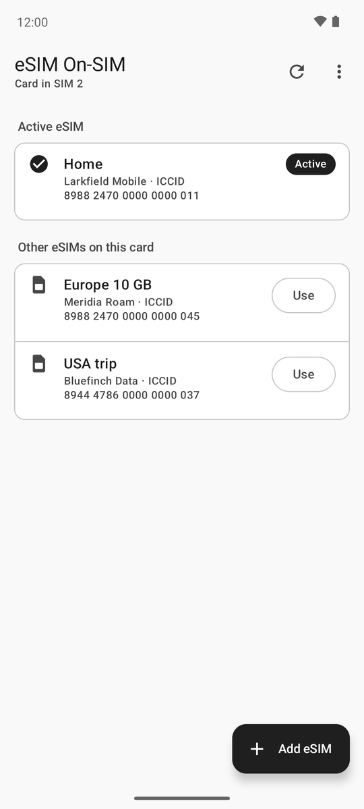
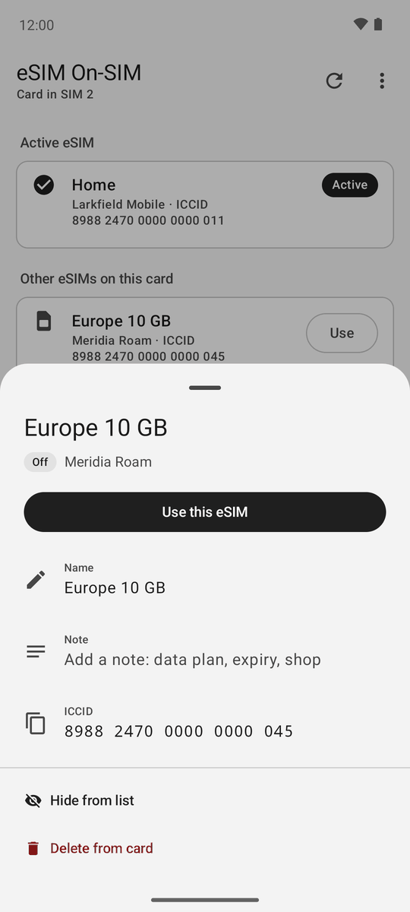
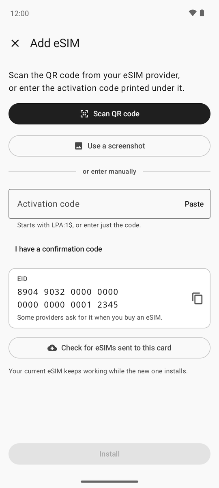
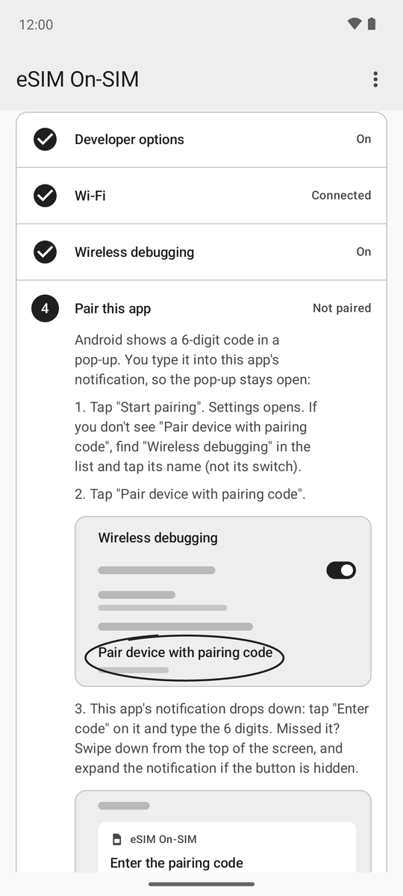

# eSIM On-SIM

**Use eSIMs on almost any Android phone with a removable eSIM card, and manage them without the card maker's app.**

  
  
  
  

### [Download the app](https://github.com/Vinciepincie/esim-on-sim/releases/latest/download/eSIM-On-SIM.apk)

About 1.6 MB, for Android 6 or newer. [How to install it](#install)

## What it does

This app manages the eSIMs on a removable eUICC: a physical SIM card that holds several eSIMs at once. It's also commonly
known as an **eSIM adapter**, a **physical eSIM card** or by its brand name, such as **5ber, 9eSIM, eSIM.me, ESTKme, XeSIM
and LinksField**.

Put one in your phone, and even a phone without eSIM support can use eSIMs. The app adds, switches, renames and deletes the
eSIMs on the card.

These cards all follow the same GSMA standard. If you try another card, please
[tell us how it went](https://github.com/Vinciepincie/esim-on-sim/issues).

> **Disclaimer:** I've only tested this app on my own phone with a 5ber card, and with simulations on virtual machines. It
> should work on other phones and cards, but I can't guarantee it. Use it at your own risk.

## Why use it

✅ **Ignores vendor lock.** Works with cards that only trust their maker's app, through root, Shizuku or Wireless debugging.

✅ **No limit on how many eSIMs you add.** The app has no software lock or download quota. The only limit is your card's
real storage.

✅ **Tiny.** About 1.6 MB to download and under 20 MB once installed. (The original apps I've looked at are way bigger.)

✅ **Fast and stable.** A native Android app that opens straight to your eSIMs. If you leave the app during an install, it
keeps going.

✅ **Doesn't depend on your card's maker.** No account and no maker's server, so your card stays useful if its app is
locked, breaks or disappears, as happened to 5ber.

✅ **Follows the official eSIM standard (GSMA SGP.22).** After you install, switch or delete an eSIM, the app tells the
provider if the eSIM asks for that, just like a phone with built-in eSIM.

✅ **Careful with your eSIMs.** Before it switches or deletes, the app checks that the eSIM is still the one you picked, so
a swapped card can't lead to deleting the wrong one.

✅ **No account, no ads, no tracking.** It only goes online to do what you asked for. [Details below](#questions).

✅ **Add eSIMs your way.** Scan the QR code, pick a screenshot of it, paste the code, or share it from an email.

✅ **Your names go with the card.** Names you give your eSIMs are saved on the card, so other phones show them too.

✅ **No Google needed.** Works on phones without Google Play services.

✅ **Android 6 through 17.**

## Install

1. On your phone, tap **[Download the app](https://github.com/Vinciepincie/esim-on-sim/releases/latest/download/eSIM-On-SIM.apk)**.
2. Open the downloaded file.
3. Android says it can't install apps from this source. Tap **Settings**, turn on **Allow from this source**, then go back.
4. Tap **Install**.

Android only asks this once for each browser or file app.

- **Android 6 or 7:** first turn on **Settings › Security › Unknown sources**, then open the file. Turn it back off
  afterwards.
- **Can't find the setting?** Search Settings for "Install unknown apps".
- **A Play Protect warning?** It's there because the app doesn't come from the Play Store. Open the warning's details and
  choose to install anyway.
- **Updating?** Install the new version the same way. Your eSIMs are on the card, and your setup stays.

## First start

Most cards only let their maker's app manage them, so this app has to reach the card another way. It tries these by itself
and uses the first that works:

| Your phone | What you do |
| --- | --- |
| Rooted | Allow the app in your root app |
| Has a card that lets any app in | Nothing |
| Runs [Shizuku](https://github.com/RikkaApps/Shizuku) | Allow the app when Shizuku asks |
| Android 11 or newer | Follow the app's checklist: about 2 minutes, no computer or root |
| Android 6 to 10 | Connect a computer once, and again after each restart. The app shows how |

The checklist uses **Wireless debugging**, an Android feature for developers. Good to know:

- Android turns it off when your phone restarts or Wi-Fi changes. Turn it back on and the app reconnects.
- You need Wi-Fi for it, so open the app on Wi-Fi before you travel. The app says what helps if you won't have any.
- Some banking apps won't open while Developer options or debugging is on. If that happens, turn them off, and turn them
  back on when you need your card.

## Questions

<b>Will my eSIMs still work if I remove this app?</b>

Yes. Your eSIMs are stored on the card, not in the app.

<b>Can I get an eSIM back after deleting it?</b>

Usually not. Most eSIMs can be downloaded only once, so you'd lose any data or credit left on it. If you just want it out
of the list, choose Hide instead.

<b>Does this work with my phone's built-in eSIM?</b>

No. Keep using your phone's Settings for that. This app is for removable cards.

<b>What does the app send over the internet?</b>

Only this:

- It downloads an eSIM you add, directly from that eSIM's provider.
- It tells a provider when its eSIM is installed, switched or deleted, if the eSIM asks for that.
- When you tap **Check for eSIMs sent to this card (SM-DS)**, it gives your card's EID to eSIM discovery servers (the one your
  card names, the GSMA's and Google's).

The app has no account or analytics, and nothing goes to the app's makers.

<b>Is Wireless debugging safe?</b>

While it's on, only devices you paired with a code can connect, and this app uses it only to reach your card. You can stop
card access at any time from the ⋮ menu.

<b>What's the other download on the Releases page?</b>

`eSIM-On-SIM-google.apk` is the same app, except it scans QR codes with Google Play services, so it doesn't ask for camera
access. It's a little bigger. Most people should use the normal download.

---

Building the app or curious how it works? See the [development notes](docs/DEVELOPMENT.md).
